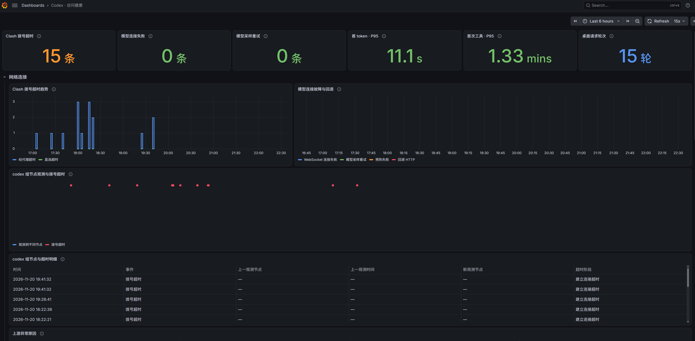

# Codex 访问健康

本机 Grafana 面板用于定位 Codex Desktop 等待、模型连接重试、Clash 拨号超时和 DNS 异常。采集器读取已有日志，把结构化事件写入 SQLite。默认回看最近 7 天，采集器与面板每 15 秒刷新。Grafana 在本机固定端口提供只读查看。



## 快速启动

需要 macOS 和 Python 3.11 或更新版本。在仓库根目录执行：

```sh
bash service.sh start
```

打开 [Codex 访问健康](http://127.0.0.1:3308/d/codex-health)。首次启动会下载并校验 Grafana OSS，安装 SQLite 数据源插件，并从可用日志回填数据。启动时间取决于下载速度和历史日志大小。没有安装 Clash Party 的机器仍然可以查看 Codex 数据。

| 操作 | 命令 |
|---|---|
| 查看后台状态 | `bash service.sh status` |
| 停止后台服务 | `bash service.sh stop` |
| 在终端前台运行 | `bash run.sh` |
| 改用本机端口 3309 | `GRAFANA_PORT=3309 bash service.sh start` |
| 单次采集到指定数据库 | `python3 collect.py --database codex-health.sqlite` |

启动命令会安装用户 LaunchAgent。每次登录 macOS 后，Grafana 和采集器都会自动启动。`bash service.sh stop` 会卸载启动项并保留数据。

后台默认使用 `~/Library/Application Support/Codex Health Grafana` 保存 Grafana、插件、SQLite 数据和日志。启动时发现 SQLite 插件缺少关键文件，会从已缓存的安装包补齐。`service.sh status` 会显示服务日志路径，`GRAFANA_HOME` 可以指向已有的 Grafana 安装目录。

从旧版临时目录安装升级时，先停止旧服务并备份原运行目录，再迁移历史数据。需要继续使用已有的持久运行目录时，可以在启动命令前指定 `GRAFANA_RUNTIME_DIR`。

## 面板怎么读

- **网络连接**显示模型连接失败、HTTP 回退、Clash 拨号超时，以及 `codex` 组中首次观测到不同节点的时间。节点变化来自转发日志，精确的 `url-test` 切换需要额外的内核事件。
- **DNS 解析与上游**把域名解析失败、DNS 上游连接异常和代理拨号超时对齐。明细可以查解析器、出站组、实际节点和错误分类。上游连接取消单独统计。现有日志可以对齐连接阶段，完整 DNS 查询成功率和耗时需要逐查询事件。
- **会话体验**显示首 token、首次工具动作和总耗时，帮助定位 Thinking 发生在哪个阶段。
- **采集状态**显示最近一次写入和各日志来源的可用性。
- **App Server 诊断**显示桌面端的 JSON-RPC 耗时、返回错误和连接事件。RPC 返回错误率的分母是已收到响应的调用，包含后台文件和插件操作。

## 开发与验证

```sh
python3 -m unittest discover -s tests -v
python3 build_dashboard.py
bash -n run.sh service.sh
git diff --exit-code -- dashboard.json
```

`collect.py` 是采集入口。`build_dashboard.py` 生成面板 JSON，修改面板时提交两者。AI agent 可以从 [AGENTS.md](AGENTS.md) 开始，数据表和采样边界见 [架构说明](docs/architecture.md)。

现有 Grafana 实例也可以安装 [SQLite 数据源插件](https://grafana.com/grafana/plugins/frser-sqlite-datasource/)，将 UID 为 `codex-health-local` 的只读数据源指向采集器生成的数据库，再导入 `dashboard.json`。

数据库、真实日志和机器配置属于运行环境。示例验证使用临时目录和合成事件。
