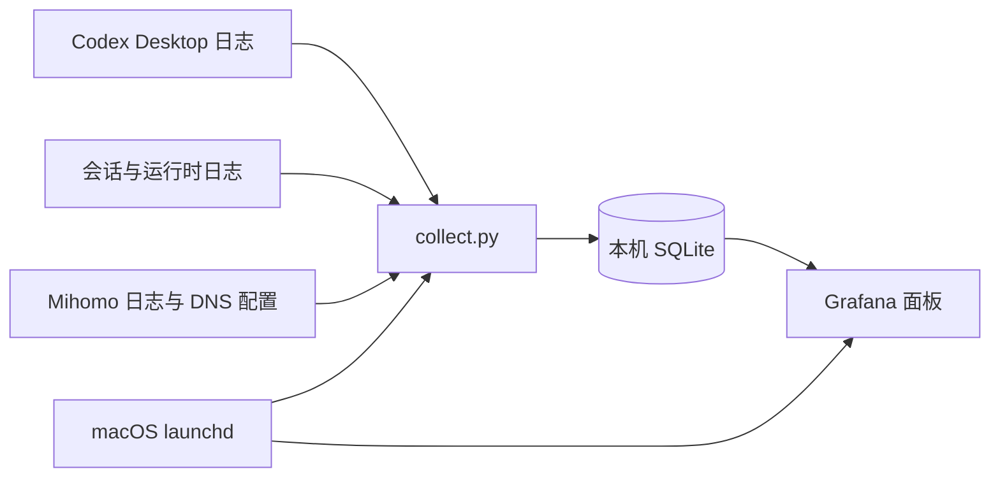

# 架构与指标口径

## 采集与启动

`service.sh` 安装用户 LaunchAgent，在每次登录时启动任务。项目文件和 SQLite 数据默认保存在用户的 `Library/Application Support` 中。`run.sh` 启动采集器和 Grafana，并监听两个进程。Grafana 绑定 `127.0.0.1`，使用 Viewer 角色和只读 SQLite 数据源。

每轮采集重用未变化文件的解析结果，读取新增或变化的日志文件，并在一个 SQLite 事务中发布整个滚动窗口。Grafana 与采集器使用独立的 15 秒刷新周期。日志保留期决定实际可回看的范围。可用 `--codex-home`、`--desktop` 和 `--clash` 指定其他本机路径。

## 数据源与 SQLite 表

| 表 | 输入及含义 |
|---|---|
| `rpc` | Codex Desktop 日志中完成匹配的 JSON-RPC 响应，含响应时间、排队时间和错误标记。 |
| `connection` | Desktop 记录的 App Server 初始化、状态变化和显式超时。 |
| `turns` | Codex 会话记录的桌面主会话轮次。首 token 使用已记录值，首次工具优先使用启动时间，缺失时使用调用事件时间。 |
| `upstream` | Codex 本地运行日志中记录的模型 WebSocket 连接失败、重试、预热失败和 HTTP 回退。 |
| `proxy` | Mihomo 连接 ChatGPT/OpenAI 域名的拨号错误，按直连或代理、错误类型归类。 |
| `clash_timeline` | `codex` 组的拨号超时和转发中观测到的节点变化，保存前一次观测作为上下文。 |
| `dns_events` | Mihomo 明示的解析失败，以及已知 DNS 上游的出站连接、异常与取消。 |
| `sources` 和 `capture` | 来源读取情况、最近一次成功采集时间和历史窗口起点。 |

## DNS 诊断

采集器从当前 Mihomo 工作配置和保留的本机配置中识别 DNS 上游地址。它用地址和端口匹配 Mihomo 内部连接，提取日志所示的出站组和节点。解析失败按公开服务域名范围归类，其余目标汇总显示。读取范围之内尚未被保留的旧 DNS 配置可能造成早期上游记录缺失。

- `resolve_error` 表示内核日志明示的域名解析失败。
- `upstream_routed` 表示日志记录了到解析器的出站连接。
- `upstream_error` 表示内核记录了到解析器的连接异常。
- `upstream_canceled` 保留取消的连接，独立于异常计数。

DNS 曲线还读取 `clash_timeline` 中 `codex` 组的拨号超时，时间接近可用于调查。现有日志缺少跨阶段请求 ID，关联按时间观察。

## 统计

延迟 P95 使用时间范围内有样本的原始耗时计算，图表按所选范围调整分桶。故障数按日志条数统计，同一次请求可能产生多条。节点明细中的“上一观测节点”来自最近一条成功路由记录，适合定位线索。当前配置、数据库与运行时文件由用户环境提供。
